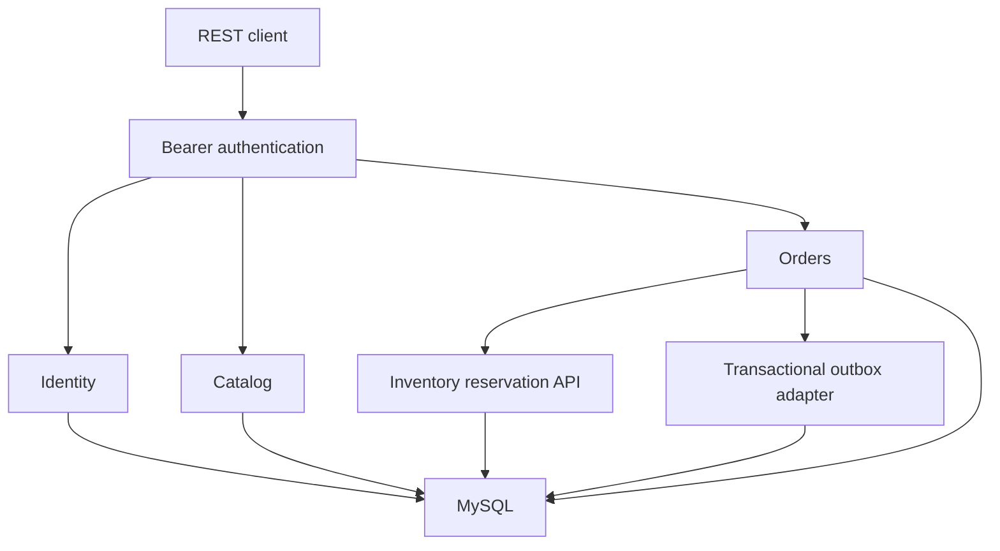

# Architecture and domain

## Implemented topology

All modules run in one JVM with one database and transaction manager. The inventory interface is implemented within catalog persistence. Repositories/entities remain package-private where practical. No Kafka publisher or network call between modules exists yet.

| Record | Persisted contract |
| --- | --- |
| app_users | Normalized unique email, BCrypt hash, role and active state |
| access_tokens | Token digest, user foreign key and expiry |
| products | Unique SKU, decimal money, available/reserved stock and version |
| customer_orders | Authenticated owner, RESERVED state, currency/total and creation time |
| order_lines | Immutable product/name/price/quantity snapshots with line-total constraints |
| idempotency_requests | Unique customer/key digest, normalized request hash, linked order |
| outbox_events | Durable versioned ORDER_RESERVED JSON and unpublished marker |

V1 is unchanged. V2 adds the order-side tables and foreign keys without replacing existing identity/catalog data.

## Transactions and concurrency

[ADR 3](adr/0003-transactional-order-creation.md) defines the creation boundary. One READ COMMITTED transaction claims idempotency, locks/reserves inventory in deterministic order, saves order snapshots, completes the claim and inserts the outbox event.

JpaTransactionManager coordinates JPA and JdbcTemplate on the same DataSource. Inventory, claim and outbox adapters require that transaction. A runtime failure rolls back all effects, including earlier flushed writes. Database deadlocks are still possible; transient database errors expose a retryable 503 instead of pretending success.

Order reads enforce ownership in the application service. ADMIN may read a specific order; lists always contain only the caller's orders. Summaries do not eagerly fetch every line collection.

## Testing boundaries

Unit tests cover money, stock, canonical request fingerprints and order totals/snapshots. MySQL/Testcontainers tests cover migration/schema, HTTP authorization, scoped retries, actual concurrent reservations and rollback after an injected outbox insertion failure.

SchemaUpgradeIT verifies that applying V2 after populated V1 preserves identity/catalog records. A loopback-only Python smoke script exercises the actual Compose application's order/replay endpoints. Runtime evidence must come from executed CI, not compilation.

## Current limits

Only creation into RESERVED is implemented. No stock consumption/release transition, expiry job, payment processing, Kafka publisher/consumer, Redis, audit trail, load benchmark or public deployment is claimed.
