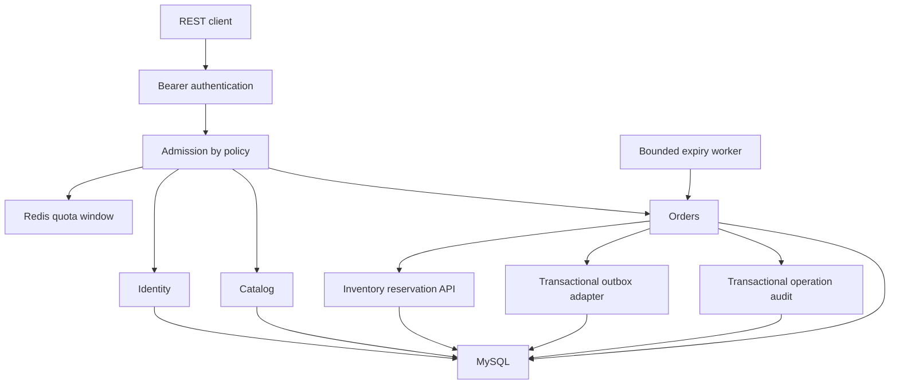

# Architecture and domain

## Implemented topology

All modules run in one JVM with one database and transaction manager. The inventory interface is implemented within catalog persistence. Repositories/entities remain package-private where practical. [CF-05 messaging](MESSAGING.md) adds a leased Kafka publisher and an asynchronous projection consumer. Broker I/O runs outside the order transaction. Inbox and projection commit together; no consumer changes authoritative stock or order state.

| Record | Persisted contract |
| --- | --- |
| app_users | Normalized unique email, BCrypt hash, role and active state |
| access_tokens | Token digest, user foreign key and expiry |
| products | Unique SKU, decimal money, available/reserved stock and version |
| customer_orders | Owner, terminal state machine, creation/deadline/completion times, digest-only simulated payment metadata |
| order_lines | Immutable product/name/price/quantity snapshots with line-total constraints |
| idempotency_requests | Unique customer/key digest, normalized request hash, linked order |
| outbox_events | Durable versioned reservation/completion JSON and unpublished marker |

V1 and V2 are unchanged. V3 extends order states and outbox types, adds payment metadata and backfills existing reservation deadlines; see [ADR 4](adr/0004-order-lifecycle.md).

## Transactions and concurrency

[ADR 3](adr/0003-transactional-order-creation.md) defines the creation boundary. One READ COMMITTED transaction claims idempotency, locks/reserves inventory in deterministic order, saves order snapshots, completes the claim and inserts the outbox event.

JpaTransactionManager coordinates JPA and JdbcTemplate on the same DataSource. Inventory, claim and outbox adapters require that transaction. A runtime failure rolls back all effects, including earlier flushed writes. Database deadlocks are still possible; transient database errors expose a retryable 503 instead of pretending success.

Lifecycle transactions lock the order first, read time after the lock, then consume or release inventory in fixed product order. State, stock, simulated payment outcome and completion outbox share a commit boundary. The worker processes at most 100 due IDs per scan, with a separate transaction for each ID.

Order reads enforce ownership in the application service. ADMIN may read a specific order; lists always contain only the caller's orders. Summaries do not eagerly fetch every line collection. Lifecycle writes are owner-only, including against ADMIN tokens.

## Testing boundaries

Unit tests cover money, stock, canonical request fingerprints and order totals/snapshots. MySQL/Testcontainers tests cover migration/schema, HTTP authorization, scoped retries, actual concurrent reservations and rollback after an injected outbox insertion failure.

SchemaUpgradeIT populates V1 identity/catalog, applies V2 and creates an existing reserved order, then verifies preservation and its backfilled lease after V3. A loopback-only Python smoke script exercises actual order, payment/replay, cancellation/replay and decline endpoints. Runtime evidence must come from executed CI, not compilation.

## Current limits

The local simulated lifecycle is implemented; see [LIFECYCLE.md](LIFECYCLE.md). Kafka publisher/consumer and operator recovery audit are implemented in CF-05. CF-06 adds Redis admission and order audit/metrics; the [operability contract](OPERABILITY.md) defines outage and commit semantics. No real provider/refunds, complete audit trail for every operation, benchmark or public deployment is claimed. Expiry scans are bounded and have no exact timing SLA.

## Messaging persistence
V4 preserves V1–V3 and backfills message_dispatch from business outbox rows.
message_dispatch stores immutable bytes, fenced leases and bounded retries. message_inbox deduplicates
within the projection transaction. message_dead_letters and message_operator_requests retain durable
recovery and idempotent actor-attributed operator actions. [ADR 5](adr/0005-durable-kafka.md) describes
acknowledgement boundaries and tradeoffs; the messaging diagram describes the implemented flow.

## Admission and audit boundaries
Authorization precedes Redis admission; logout/reads remain available when write admission fails.
V5 starts order_operation_audit without invented history. Audit changes share the business transaction;
transition counters run after commit. Redis stores no authoritative order/stock/idempotency state.
See [ADR 6](adr/0006-admission-audit-metrics.md).
