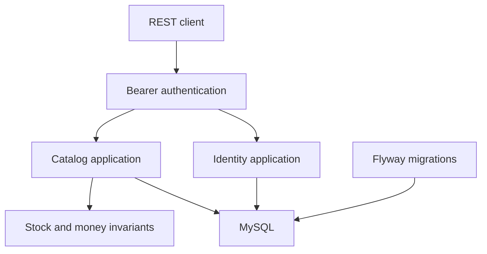

# Architecture and domain

## Implemented topology

Java package boundaries define the current modules. Repositories/entities are package-private where practical; cross-module code uses application services or domain value objects. There is one Spring Boot process and one MySQL database. There are no network calls between modules and no implemented messaging pipeline yet.

| Record | Persisted contract |
| --- | --- |
| app_users | Unique normalized email, BCrypt hash, ADMIN/CUSTOMER role, active state |
| access_tokens | SHA-256 digest, user foreign key, expiry; no plaintext token |
| products | Unique SKU, DECIMAL(19,2), supported currency, on-hand/reserved counts and version |

MySQL CHECK constraints protect stock non-negativity, reserved <= on-hand, positive price and supported currency. Domain Money rejects mixed-currency addition, fractional cents, overflow and negative values. Domain Stock cannot reserve beyond availability or release/consume more than reserved.

## Transactions and concurrency

Registration, token issuance/revocation, bootstrap and product creation use application-service transactions. Unique email/SKU constraints resolve competing writes at the database boundary and map conflicts to 409. JPA validates the Flyway schema; it never updates schemas automatically.

The stock primitive is immutable. This increment does not expose reservation operations or claim transaction-safe order processing. A product version field alone is not evidence that concurrent reservations are implemented. CF-03 will introduce a single transaction spanning order snapshots, scoped idempotency, locked inventory and outbox persistence, with real competing-order and rollback tests.

## Testing boundaries

Unit tests cover numerical/inventory invariants and verify that invalid catalog values do not reach persistence. CommerceFlowIT starts real MySQL, applies migrations, validates JPA mappings and exercises HTTP authentication and catalog behavior. No external providers are involved.

Container startup is verified separately by CI Compose smoke checks. Local unit success does not imply Docker/MySQL success.

## Limits

No order table, payment state machine, audit history, outbox publisher, Kafka consumer, Redis dependency, service extraction, production benchmark or deployment exists in this increment. They remain explicit roadmap work.
