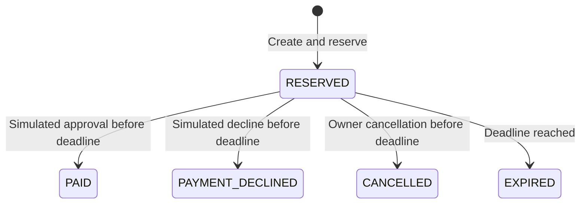

# Order lifecycle — simulated payments and expiry

## Implemented state machine



All four terminal states are immutable. The response includes expiresAt and completedAt.
The 15 minute deadline belongs to the order, independently of the 15 minute access-token lifetime:
re-authenticating does not extend a reservation.

| State | Stock effect | Completion event |
| --- | --- | --- |
| PAID | Reduce on_hand and reserved by each line quantity | ORDER_PAID |
| PAYMENT_DECLINED | Reduce reserved only | ORDER_PAYMENT_DECLINED |
| CANCELLED | Reduce reserved only | ORDER_CANCELLED |
| EXPIRED | Reduce reserved only | ORDER_EXPIRED |

Each event has a new UUID, event_version 1, order/customer identifiers, status, total, currency and
occurrence timestamp. It excludes bearer credentials and payment idempotency digests.
ORDER_RESERVED retains its existing version-1 snapshot payload.
Events remain unpublished outbox rows; there is no Kafka publisher in CF-04.

## Owner API

Only the owner may mutate an order. Another user or an administrator acting on someone else's order
receives 404. Missing/invalid authentication receives 401.

```http
POST /api/orders/<order-uuid>/simulated-payment
Authorization: Bearer <accessToken>
Idempotency-Key: payment-checkout-0001
Content-Type: application/json

{"decision":"APPROVED"}
```

Use DECLINED to exercise the failure path. These are synthetic decisions chosen by a caller;
no financial provider or real transaction is involved.

- First completed decision: 200, body PAID or PAYMENT_DECLINED, Idempotency-Replayed: false.
- Same order/key/decision retry: 200 with identical terminal order, Idempotency-Replayed: true.
- Different key/decision after payment: 409 idempotency_conflict.
- Payment after cancellation: 409 order_state_conflict.
- Missing/malformed key, missing/null/unknown decision: 400.
- Keys follow the same 8–128 ASCII character rules as creation. Payment keys are scoped to the
  order; they do not conflict with creation keys or payments for another order.
- If the lease has elapsed, payment returns 200 with EXPIRED, replayed false, and no payment
  outcome/digest. Clients must check the returned status, rather than interpret HTTP 200 as approval.
- A completed payment still replays after its former deadline without releasing sold stock.

```http
POST /api/orders/<order-uuid>/cancel
Authorization: Bearer <accessToken>
```

Cancellation returns 200/CANCELLED; repeating it returns the same order with no new release/event.
A due reservation returns 200/EXPIRED. A paid or declined order returns 409; no refund is attempted.
Repeated creation with its original creation key returns the same order ID and snapshots, including
its current lifecycle state; it does not create a new reservation.

## Expiry worker and recovery

The application scans at most 100 due IDs each 60 seconds, with a 60 second initial delay.
The scanner selects candidates through the status/deadline index and calls the transactional service
separately for each order. It rechecks state and time under lock. A scan or order failure is logged
without credentials; rolled-back orders remain eligible for a later scan. Applications that were
stopped can catch up from durable deadlines when restarted.

The worker is internal, with no public expiry endpoint.
Set commerceflow.reservations.scheduling-enabled=false to disable it;
commerceflow.reservations.scan-delay-ms changes both delay settings.
A backlog, database outage or application downtime can postpone physical stock release.
Payment/cancellation still enforce the deadline when they acquire the order lock.

## Verification and limits

Unit tests exercise exact deadline boundaries and terminal guards. MySQL tests inject late outbox
failure for approval, decline, cancellation and expiry; verify rollback and retry; race payment
retries, payment/cancellation and multiple expiry attempts; and exercise shared product locking.
Upgrade tests populate V1 and V2 before applying V3. The actual Compose HTTP smoke covers
reservation, approval/replay, cancellation/replay and decline.

The scheduled annotation's wall-clock timing is not covered by a sleep-based end-to-end test:
batch failure isolation is unit tested, the due-ID query and expiry transactions are integrated
against MySQL, and the Compose application starts with scheduling enabled.
Consult [verification evidence](VERIFICATION.md) and PR #3 for actual execution results.

No real payments, refunds, distributed messaging, external exactly-once processing, deployment,
production load benchmark or complete financial/audit subsystem is claimed.
