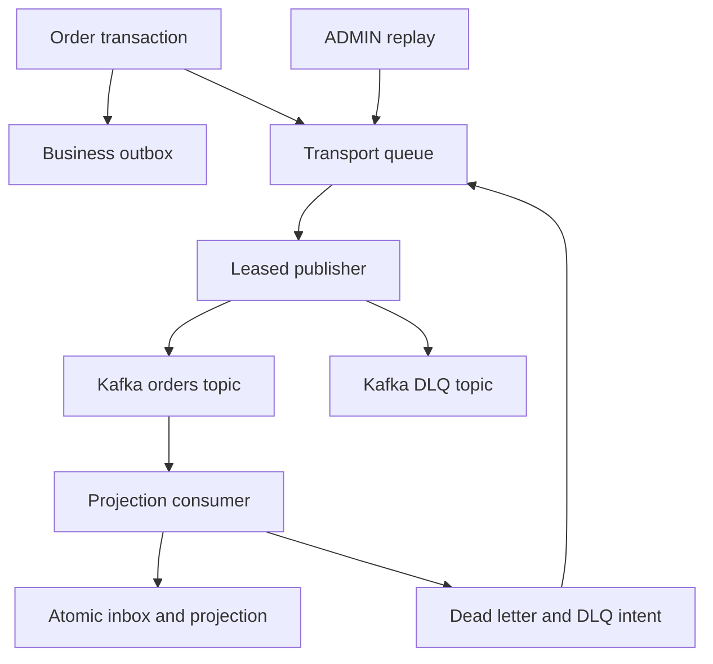

# Durable messaging

CF-05 adds a leased publisher, Kafka order projection, atomic inbox, durable dead-letter recovery
and bounded audited operator replay. See [verification](VERIFICATION.md) for executed evidence.

## Commit boundaries



The business outbox and transport intent commit with the order/stock transaction.
Publisher claims commit before network I/O. A 30 second lease token fences DB completion/failure;
the scanner attempts at most 10 records per scheduled invocation, normally each second.
SKIP LOCKED can temporarily yield no claimable work while another scan holds locks; later polls recover it.

Five publication attempts use 1/2/4/8 second delays; exhaustion becomes durable FAILED.
An abandoned fifth lease also becomes FAILED. Kafka acks=all and producer-session idempotence
do not close the broker-ack/database-mark crash window. Recovery can publish the same event twice.
FAILED means unconfirmed publication, not proof that Kafka never received the message.
SENT/published_at confirms broker acknowledgement recorded in MySQL, not consumer application.

Source messages carry sequence 1 (reservation) or 2 (terminal), and order UUID as Kafka key.
The second source message is blocked until the first is SENT. A failed predecessor blocks its
order until operator retry. Global ordering across orders or operator replay is not promised.

The consumer commits event UUID/exact-wire digest and projection change in one transaction,
then acknowledges Kafka. Equivalent redelivery is a no-op; changed bytes under the same UUID
are poison. It enforces customer consistency and contiguous sequence. It never changes authoritative
order state or inventory. The exact-wire replay contract does not accept arbitrary reserialization.

## Failure recovery

Malformed records go directly to durable recovery. Transient/out-of-order failures receive two
blocking retries (three attempts total, 250 ms delays). Recovery stores original topic/partition/offset,
bounded original value/key and SHA-256 digest, and enqueues Kafka DLQ transport in one transaction.
The original offset advances only after that commit. Failed DLQ publication is retried independently.

DLQ messages contain recovery identity, coordinates, digest, replayability and bounded original data.
They are not automatically consumed by the order listener. Values above 256 KiB, tombstones or keys
above 128 characters retain coordinates/digest without a replayable value. Application APIs expose
metadata, not raw payloads or keys. DLQ database/broker data may contain business data; retention
and cleanup are not implemented.

## API

Bearer required. GET /api/orders/{id}/projection first checks authoritative ownership (or ADMIN),
then returns orderId, status, sequence and eventId. WAITING/sequence 0 means no projection yet.
The actual order API remains authoritative and can be ahead of the projection.

ADMIN-only metadata lists, size 1..100:

- GET /api/admin/messaging/failures?size=20
- GET /api/admin/messaging/dead-letters?size=20

```http
POST /api/admin/messaging/failures/<dispatch-uuid>/retry
Authorization: Bearer <admin-token>
Idempotency-Key: operator-retry-0001
```

Only FAILED transport rows can start a new cycle; at most three operator retry cycles per row.

```http
POST /api/admin/messaging/dead-letters/<dead-letter-id>/replay
Authorization: Bearer <admin-token>
Idempotency-Key: operator-replay-0001
```

Replay queues exact retained bytes/key and preserves event identity. The same target/action/key
returns the same dispatch without another cycle. Keys are hashed; actor and request time are
persisted. At most three new replays per dead letter are allowed. No payload-edit endpoint exists.
Repair the failing dependency or missing predecessor before replay; malformed bytes remain malformed.

Anonymous requests receive 401, non-ADMIN operator requests 403, missing targets 404,
exhausted/incompatible state 409 message_state_conflict, invalid key/size 400.
Replay after an already-applied event still passes through inbox deduplication.

## Local execution

Compose runs MySQL, JVM-based apache/kafka:4.1.1 in KRaft mode, and the app.
Kafka uses a named volume, loopback-only external 9092 and internal kafka:19092.
Topics have three partitions and replication factor 1; the broker uses local PLAINTEXT.
No public or paid broker is used. This is not production ACL/TLS or multi-broker resilience.

Host messaging defaults off (CF_MESSAGING_ENABLED=false), retaining queued intent without broker I/O.
Compose explicitly enables messaging and supplies CF_KAFKA_BOOTSTRAP.
DB readiness is not proof of message delivery. The scheduler has two threads so broker waits do
not monopolize the reservation-expiry job.

Tests disable polling/listener auto-start via commerceflow.messaging.scheduling-enabled and
commerceflow.messaging.listener-auto-startup. KafkaDeliveryIT starts real disposable MySQL/Kafka
and controls the listener explicitly. Between cases only, its stopped consumer group is reset to
topic ends before deleting test DB state. Offsets are never reset inside a recovery scenario or
by production code.

The suite covers broker acknowledgement followed by DB failure, duplicates, expired leases,
actual unavailable broker, concurrent publishers/consumers, atomic DLQ capture and offset retention,
rollback/repaired replay, malformed/changed/out-of-order events, ownership and operator budgets.
Compose HTTP smoke observes PAID, CANCELLED and PAYMENT_DECLINED projections at sequence 2.

No external exactly-once guarantee, real payment, production broker security, full advisory audit,
retention policy, load benchmark or public deployment is claimed.
