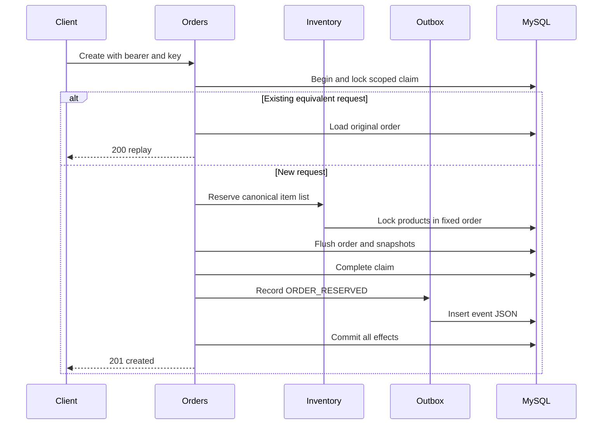

# Order creation and reservation

Implemented in the order increment; this is not yet the payment/messaging MVP.

## API

All routes require an explicit bearer token.

```http
POST /api/orders
Authorization: Bearer <accessToken>
Idempotency-Key: checkout-0001
Content-Type: application/json

{"items":[{"productId":"<product-uuid>","quantity":2}]}
```

The server owns customer identity, prices, currency and totals. Requests contain 1–50 distinct products, quantity 1–1000 per line and one currency across the server-side prices. Keys contain 8–128 ASCII letters/digits or . _ : - and are scoped to the authenticated account.

- First creation: 201, Location and Idempotency-Replayed: false.
- Equivalent retry: 200, same order ID and snapshots, Idempotency-Replayed: true.
- Same key/different normalized payload: 409 idempotency_conflict.
- Insufficient stock: 409 insufficient_stock, with no committed claim/order/event.
- Invalid input/key or mixed currencies: 400.
- Missing product/order: 404.
- GET /api/orders/{id}: owner or ADMIN; other accounts receive 404.
- GET /api/orders?page=0&size=20&status=RESERVED: only the caller's summaries, including when the caller is ADMIN. Maximum size 100.
- Transient DB failure: 503 database_busy and Retry-After: 1; retry with the same key.

Order lines snapshot SKU, name, unit amount, quantity and line total. The order's total/currency are persisted. Catalog edits do not change existing orders. Listing returns summaries without loading every line collection.

## Implemented transaction



All application participants run in one JVM and use one database transaction. The replay also completes its read transaction before the response is committed.

## Event storage

outbox_events stores an event ID, order ID, ORDER_RESERVED type, version 1, JSON snapshot, occurrence time and null published_at. It is durable and atomic with the order. There is no background publisher or Kafka delivery yet; a pending row is not a delivered message.

## Verification design

OrderFlowIT uses real MySQL and concurrent HTTP requests through MockMvc. It checks scoped/reordered retries, changing payloads, ownership, snapshots, concurrent same-key attempts, competing stock requests and opposite line order.

Failure tests include a missing/insufficient later product and a temporary MySQL trigger rejecting outbox insertion after the order flush. They assert rollback of reservations, order/lines, claim and event, then retry successfully. SchemaUpgradeIT applies V1, inserts synthetic existing data and applies V2 to verify preservation.

The CI also runs scripts/smoke-orders.py against the actual loopback-only Compose application. The script creates disposable fixture accounts/products and checks reservation/replay over network HTTP. It does not contact providers or accept a non-loopback host.

Local unit tests and compilation are recorded separately from MySQL/container execution. Consult CI evidence before claiming these integration scenarios passed.

## Current limits

Only RESERVED exists. Stock is held until a future payment/cancel/expiry implementation; no reservation expiry job exists. This is appropriate for local staged evaluation, not an assertion of production readiness.

No outbox publisher, Kafka, inbox deduplication, retry/DLQ mechanism, Redis, real payment or public deployment is implemented. Idempotency persistence and stock locks solve creation-side effects; they do not establish exactly-once messaging.
